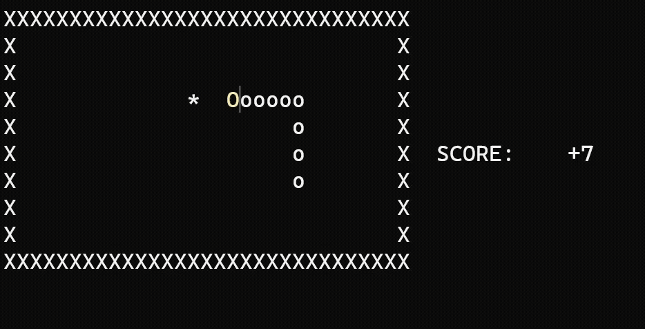

# SNAKE SOLVER

An autonomous Snake game solver developed in x86 Assembly, featuring Dijkstra's shortest-path algorithm and custom simulation-based path validation to reduce the risk of self-trapping.

## Overview 
Snake Solver is an autonomous Snake game solver developed in x86 Assembly using the Irvine32 library. Its primary objective is to complete the game in the fewest possible moves while avoiding collisions and self-trapping.

The solver uses Dijkstra's shortest-path algorithm to identify efficient routes toward apples. However, because the shortest path does not necessarily guarantee the snake's continued survival, a custom simulation-based path validation algorithm evaluates candidate routes by simulating future movement and checking tail reachability.

By combining shortest-path calculations with predictive safety checks, the solver is able to minimize unnecessary movement while ensuring the snake's continued survival to obtain more apples.

## Showcase:

  

## FULL PRESENTATION VIDEO: 
  - https://youtu.be/OIwKVs11p5E
    
  

## Key Features

- **Autonomous Gameplay:** Controls the snake automatically without requiring manual directional input.
- **Dijkstra's Shortest-Path Algorithm:** Computes routes toward apples using a graph representation of the game board.
- **Custom Path Validation:** Simulates candidate routes and evaluates future movement possibilities before accepting them.
- **Tail-Reachability Analysis:** Checks whether the snake can navigate toward its tail after following a proposed path.
- **Dynamic Obstacle Handling:** Updates the graph representation to account for the snake's changing body positions.
- **Fallback Navigation:** Uses alternative movement strategies, such as multi-level waypoint-based pathfinding and tail-following, when a direct path is unavailable.
- **Console-Based Visualization:** Displays the game board, snake, apples, and score.

## Algorithm Design

### 1. Graph Representation

The game board is modeled as a graph using an adjacency matrix.

Each playable cell represents a vertex, with edges connecting horizontally and vertically adjacent cells.

The adjacency matrix is updated to account for the snake's body, treating occupied positions as obstacles during pathfinding.

### 2. Shortest-Path Calculation

Dijkstra's algorithm calculates the shortest available path from the snake's current position toward an apple.

Because the snake's position and body configuration change throughout gameplay, pathfinding is repeatedly performed using the updated board representation.

However, the shortest available path is not necessarily a safe path.

A route can reach an apple without an immediate collision while leaving the snake trapped afterward.

### 3. Simulation-Based Path Validation

To address this limitation, the solver implements a custom validation procedure that evaluates candidate paths before execution.

The validation process involves:

1. **Candidate Path Generation:** Calculate a path toward the apple using Dijkstra's algorithm.
2. **Forward Simulation:** Simulate the snake's movement along the candidate path using temporary position data.
3. **Graph Reconstruction:** Update the simulated adjacency matrix to reflect the snake's predicted body configuration.
4. **Tail-Reachability Check:** Determine whether a route toward the snake's tail remains available. If so, the path is considered valid.
5. **Path Evaluation:** Use the validation results to determine whether to follow the candidate route or consider alternative movement.

This approach evaluates both immediate path availability and potential future mobility.

### 4. Alternative Navigation - Multi-Level Waypoint-Based Pathfinding

When the shortest path to an apple fails safety validation, the solver explores alternative routes through intermediate vertices (waypoints).

For each candidate waypoint, the solver simulates the snake's movement, dynamically updating its body positions and reconstructing the graph to reflect the predicted game state. From this updated state, Dijkstra's algorithm calculates a path from the waypoint to the apple. The complete route is then evaluated through simulation-based validation, including tail-reachability checks to assess future mobility and the risk of self-trapping.

If validation fails, the algorithm expands its search to nearby waypoints, recursively exploring additional intermediate routes. Only paths that satisfy the safety criteria are accepted, allowing the solver to find viable alternatives to the shortest path while accounting for the snake's changing body configuration. If no valid route to the apple can be found, the solver falls back to tail-following navigation to maintain movement while searching for a viable path.

## Technical Implementation

**Language:** x86 Assembly (MASM syntax)

**Library:** Irvine32

**Platform:** Windows

**Core Concepts:**

- Graph representation using adjacency matrices
- Dijkstra's shortest-path algorithm
- Forward simulation and path validation
- Dynamic obstacle tracking
- Array and memory manipulation
- Register-level programming
- Modular Assembly procedures

## Implementation Highlights

The solver separates its functionality into procedures responsible for graph construction, pathfinding, simulation, movement, and rendering.

Some of the core procedures include:

| Procedure | Responsibility |
|-----------|----------------|
| `initialize_adj_matrix` | Constructs the graph's adjacency matrix |
| `djikstra_algo` | Calculates shortest-path information |
| `travel_test_path` | Simulates movement along a candidate path |
| `travel_tail_test_path` | Simulates additional movement along a tail-directed path |
| `test_path` | Coordinates candidate path validation |
| `follow_tail` | Handles fallback tail-following movement |
| `move_decider` | Determines which movement strategy to execute |

## Development Challenges

The primary challenge was implementing an autonomous solver that could account for the changing geometry of the snake's body.

Dijkstra's algorithm alone was insufficient because a shortest path could lead the snake into a position with limited future movement options.

To address this, I developed a simulation-based validation procedure that evaluates candidate routes using temporary game states and additional pathfinding checks.

Implementing these algorithms in Assembly required explicit management of memory, arrays, registers, and control flow.

## Project Information

**Project:** Snake Solver — Final Project

**Developer:** Queency Tan

**Language:** x86 Assembly
